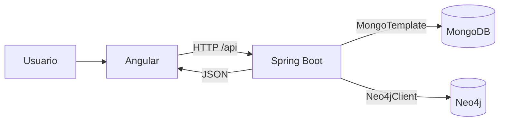

# Arquitectura de Admisiones USAC

Decisiones para las secciones 3, 4, 8 y 11 del brief y C01-09. MongoDB y Neo4j son obligatorios; Angular, Spring Boot y las bibliotecas son decisiones del proyecto.

## Componentes y comunicación

El frontend está en `frontend/` y la API en `backend/`. Las bases se ejecutan como servicios independientes con volúmenes persistentes en `compose.yaml`. Esta separación concentra credenciales, validación y acceso a datos en el backend. El navegador solo recibe resultados de la API.

Angular usa componentes standalone, rutas bajo demanda, TypeScript estricto y señales para los estados de interfaz. `ApiService` centraliza las solicitudes; `apiErrorInterceptor` produce mensajes en español y conserva la respuesta HTTP. Spring Boot usa sus integraciones con ambos motores y Bean Validation. Actualmente solo existe el endpoint de diagnóstico; los controladores funcionales se implementarán con validación y transformación en servicios del backend.

Se conserva Java 25 y Angular 21 según la configuración existente. El POM, Maven Wrapper y `package-lock.json` describen las dependencias y herramientas de construcción.

En desarrollo, Angular se sirve en `localhost:4200` y su proxy reenvía `/api/**` a `localhost:8080`, conservando el prefijo. El navegador usa el mismo origen y no necesita CORS para este recorrido. En producción, el servidor del frontend deberá reenviar `/api/**` y servir `index.html` para sus rutas; ese despliegue aún está pendiente.

La API importa `.env` y permite sobrescribir valores mediante variables del proceso. `.env.example` documenta la configuración; `.env` permanece excluido de Git. Los puertos de las bases están publicados solo en `127.0.0.1` para desarrollo local. No se incluyen credenciales en Angular.

## Diagnóstico y errores

`GET /api/health` ejecuta un `ping` autenticado en MongoDB y `RETURN 1 AS connected` en la base configurada de Neo4j, sin escribir datos. Comprueba ambos motores aunque falle uno y no devuelve detalles internos de excepciones.

| Condición | HTTP | JSON |
| --- | --- | --- |
| Ambos disponibles | 200 | `{"status":"UP","mongodb":"UP","neo4j":"UP"}` |
| Neo4j falla | 503 | `{"status":"DOWN","mongodb":"UP","neo4j":"DOWN"}` |
| MongoDB falla | 503 | `{"status":"DOWN","mongodb":"DOWN","neo4j":"UP"}` |
| Ambos fallan | 503 | `{"status":"DOWN","mongodb":"DOWN","neo4j":"DOWN"}` |

`ConnectionStatus`, presente en todas las secciones, consulta este endpoint al iniciar la aplicación. Muestra los estados parciales de un HTTP 503 y permite reintentar. Distingue fallas de red y respuestas inválidas sin bloquear la navegación. Consulta al iniciar y bajo demanda; sus estados corresponden a la última comprobación. Borra el resultado anterior mientras comprueba y cancela la petición cuando se destruye la vista.

La interfaz finaliza la espera tras 45 segundos. Este límite del cliente no garantiza cancelar una consulta ya ejecutándose en el servidor. Una conexión disponible no demuestra que existan evaluaciones cargadas ni que funcionen el ETL o las consultas analíticas.

## Visualización

Se elige **[Chart.js](https://www.chartjs.org/docs/latest/)** para estadísticas por sus gráficas habituales y tipos TypeScript. Se usarán barras para distribuciones y líneas para tendencias cuando corresponda, con tablas o cifras legibles y denominadores explícitos. No todas las consultas requieren una gráfica.

Se elige **[Cytoscape.js](https://js.cytoscape.org/)** para representar nodos y aristas, distribuirlos e interactuar con ellos y sus filtros. Recibirá JSON de la API; Cypher se ejecutará en el backend. Son decisiones de diseño basadas en las capacidades de ambas bibliotecas, no exigencias del enunciado.

Las bibliotecas se instalarán al implementar las primeras visualizaciones, fijando sus versiones en el lockfile. Todavía no están instaladas ni existen gráficas o grafos funcionales. Los límites y filtros se definirán al diseñar el modelo; el explorador deberá consultar conjuntos acotados.

## Funcionalidades siguientes

MongoDB almacenará datos procesados para agregaciones, búsquedas e historial. Neo4j representará relaciones para cinco consultas Cypher y su exploración. La revisión de los tres CSV y los criterios de identidad, conteos y edad están documentados en [../datos/DATOS_ORIGEN.md](../datos/DATOS_ORIGEN.md). Esquemas e índices se definirán en la siguiente etapa. Una fila representa una evaluación y no equivale automáticamente a un aspirante único.

El backend recibirá CSV desde Angular, validará y transformará registros y reportará resultados por archivo con causas de rechazo. La coordinación entre motores requerirá identificación de cargas parciales y reintentos; no se presupone una transacción común. Estas funciones están pendientes.

C01-08 requiere el backend funcional de carga y consultas; C01-10 requiere el recorrido con datos reales hasta su visualización. Ambas tareas siguen abiertas. La evidencia de infraestructura y las comprobaciones manuales están en [../evidencias/VERIFICACION_BASE.md](../evidencias/VERIFICACION_BASE.md).
