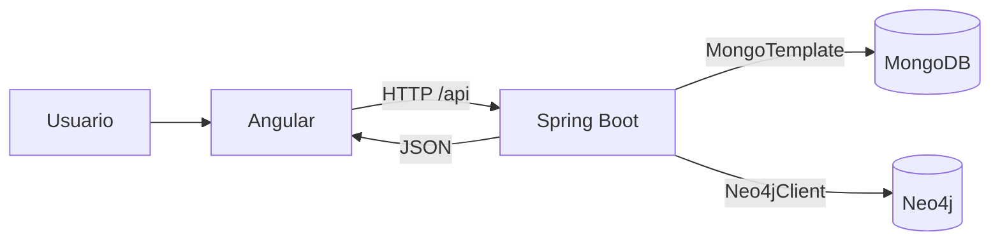

# Arquitectura de Admisiones USAC

Decisiones para las secciones 3, 4, 8 y 11 del brief y C01-09. MongoDB y Neo4j son obligatorios; Angular, Spring Boot y las bibliotecas son decisiones del proyecto.

## Componentes y comunicación

El frontend está en `frontend/` y la API en `backend/`. Las bases se ejecutan como servicios independientes con volúmenes persistentes en `compose.yaml`. Esta separación concentra credenciales, validación y acceso a datos en el backend. El navegador solo recibe resultados de la API.

Angular usa componentes standalone, rutas bajo demanda, TypeScript estricto y señales para los estados de interfaz. `ApiService` centraliza las solicitudes; `apiErrorInterceptor` produce mensajes en español y conserva la respuesta HTTP. Spring Boot usa sus integraciones con ambos motores y Bean Validation. Los controladores de diagnóstico, carga, historial, estadísticas, búsqueda y grafos reciben HTTP; los servicios coordinan los casos de uso y las consultas y conversores obtienen y transforman resultados.

Se conserva Java 25 y Angular 21 según la configuración existente. El POM, Maven Wrapper y `package-lock.json` describen las dependencias y herramientas de construcción.

En desarrollo, Angular se sirve en `localhost:4200` y su proxy reenvía `/api/**` a `localhost:8080`, conservando el prefijo. El navegador usa el mismo origen y no necesita CORS para este recorrido. En producción, el servidor del frontend deberá reenviar `/api/**` y servir `index.html` para sus rutas; ese despliegue aún está pendiente.

La API importa `.env` y permite sobrescribir valores mediante variables del proceso. `.env.example` documenta la configuración; `.env` permanece excluido de Git. Los puertos de las bases están publicados solo en `127.0.0.1` para desarrollo local. No se incluyen credenciales en Angular.

## Diagnóstico y errores

`GET /api/health` ejecuta un `ping` autenticado en MongoDB y `RETURN 1 AS connected` en la base configurada de Neo4j, sin escribir datos. Comprueba ambos motores aunque falle uno y no devuelve detalles internos de excepciones.

| Condición | HTTP | JSON |
| --- | --- | --- |
| Ambos disponibles | 200 | `{"status":"UP","mongodb":"UP","neo4j":"UP"}` |
| Neo4j falla | 503 | `{"status":"DOWN","mongodb":"UP","neo4j":"DOWN"}` |
| MongoDB falla | 503 | `{"status":"DOWN","mongodb":"DOWN","neo4j":"UP"}` |
| Ambos fallan | 503 | `{"status":"DOWN","mongodb":"DOWN","neo4j":"DOWN"}` |

`ConnectionStatus`, presente en todas las secciones, consulta este endpoint al iniciar la aplicación. Muestra los estados parciales de un HTTP 503 y permite reintentar. Distingue fallas de red y respuestas inválidas sin bloquear la navegación. Consulta al iniciar y bajo demanda; sus estados corresponden a la última comprobación. Borra el resultado anterior mientras comprueba y cancela la petición cuando se destruye la vista.

La interfaz finaliza la espera tras 45 segundos. Este límite del cliente no garantiza cancelar una consulta ya ejecutándose en el servidor. Una conexión disponible no demuestra que existan evaluaciones cargadas ni que funcionen el ETL o las consultas analíticas.

## Visualización

Las estadísticas y los resultados de G01–G10 se presentan con tablas y gráficas de barras mediante componentes Angular y CSS. Las barras muestran hasta ocho grupos por métrica; las tablas conservan todas las filas devueltas. G07 y G10 separan métricas con unidades diferentes.

El grafo usa `vis-network` sobre canvas, con zoom, desplazamiento, selección, detalle, atenuación de entidades no vecinas y controles por tipo. La muestra admite entre 5 y 40 evaluaciones (10 por defecto); el número de nodos depende de las entidades compartidas. Los filtros por año, carrera, resultado y departamento se aplican en Neo4j. Ocultar tipos es una operación de presentación sobre la muestra recibida. Véase [BIBLIOTECA_GRAFOS.md](BIBLIOTECA_GRAFOS.md).

Estas son decisiones del proyecto. Chart.js y Cytoscape fueron alternativas de la planificación inicial y no forman parte de la implementación actual.

## Funcionalidades implementadas

MongoDB conserva evaluaciones, cargas, rechazos y `resumen_carrera`. Las veinte consultas obligatorias se distribuyen entre el dashboard (18) y el detalle del aspirante (M11/M15). M21–M25 amplían el análisis y se solicitan individualmente. Cada consulta tiene su archivo; M06 materializa el resumen únicamente al solicitar el dashboard sin filtros.

Neo4j conserva las relaciones del dataset, permite ejecutar G01–G10 individualmente y devuelve una muestra para el grafo. Los Cypher residen en recursos independientes; el navegador no ejecuta consultas directamente. Los modelos e índices se describen en [MODELOS_DATOS.md](MODELOS_DATOS.md).

El ETL valida CSV, transforma registros y coordina escrituras en MongoDB y Neo4j. Los hashes, `upsert` y `MERGE` permiten reintentos. Si falla el segundo motor queda `PENDIENTE_NEO4J`; no hay transacción distribuida. Las cargas completas se reutilizan si su versión de reglas está vigente (actualmente 2). El historial persistente muestra cargas por contenido y detalles paginados de rechazados y evaluaciones válidas. Véase [ETL_CARGA.md](ETL_CARGA.md) y [API_CARGA.md](API_CARGA.md).

Los filtros HTTP de MongoDB restringen documentos antes de agregar y recalculan porcentajes y rankings. Los filtros de G01–G10 seleccionan grupos ya calculados y conservan sus conteos. Ambos son independientes de los filtros de la muestra visual. Parámetros y ejemplos: [FILTROS_ANALITICOS.md](FILTROS_ANALITICOS.md).

## Estado de verificación

C01-08 cuenta con backend funcional y evidencia de integración registrada. C01-10 conserva pendiente la aceptación del recorrido visual completo con datos reales. La inspección parcial del grafo y las pruebas automatizadas no sustituyen esa aceptación ni la demostración personal. Evidencias y límites: [VERIFICACION_ENTREGA.md](../evidencias/VERIFICACION_ENTREGA.md). Esta revisión documental del 30 de octubre de 2026 no repite pruebas operativas.
