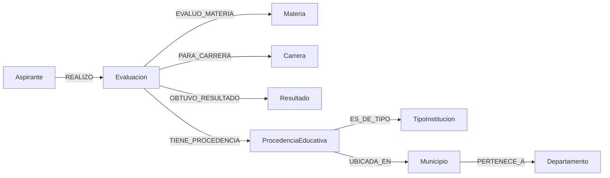

# Modelos de MongoDB y Neo4j

Alcance: C03-01 a C03-07. Este diseño usa las decisiones de identidad, calidad, métricas y edad de [../datos/DATOS_ORIGEN.md](../datos/DATOS_ORIGEN.md). Los scripts versionados de índices y restricciones están en `backend/src/main/resources/db/`; este documento local explica las decisiones.

## Principios

- Una evaluación es un registro de doce campos canónicos. No se la confunde con un aspirante ni se deduce un examen que no existe en el origen.
- `correlativo_aspirante` es una cadena opaca completa. Los cambios de longitud entre archivos son válidos.
- Categorías como carrera, municipio y departamento preservan el texto recibido, incluidos espacios externos o truncamiento. No se corrigen con suposiciones.
- `NINGUNO` y `SIN DATOS` no representan entidades reales: se conservan con una marca de disponibilidad para que cada consulta decida si los muestra o excluye explícitamente.
- El único dato de institución disponible es tipo y ubicación. No se crea una entidad con el nombre o código de un colegio inexistente en los CSV.

## MongoDB

Colecciones propuestas:

| Colección | Granularidad | Propósito |
| --- | --- | --- |
| `evaluaciones` | una evaluación distinta por los doce campos | Fuente de búsquedas, historial y agregaciones. |
| `cargas` | un archivo por SHA-256 | Auditoría, reintentos y estado de sincronización de ambos motores. |
| `resumen_carrera` | una carrera y cohorte de ingreso | Materialización regenerable de M06. |

### `evaluaciones`

```json
{
  "_id": "sha256 de los 12 valores canónicos",
  "aspiranteId": "correlativo_aspirante original",
  "fechaAsignacion": "Date(ISO-8601)",
  "sexo": "M",
  "anioNacimiento": 2003,
  "edadIngreso": 19,
  "materia": "MATEMATICA",
  "oportunidad": 2,
  "anioIngreso": 2022,
  "aprobacion": "NO APROBADO",
  "carreraObjetivo": "INGENIERIA INDUSTRIAL",
  "carreraObjetivoConocida": true,
  "procedencia": {
    "departamento": "GUATEMALA",
    "municipio": "MIXCO",
    "tipoInstitucion": "PRIVADO",
    "departamentoConocido": true,
    "municipioConocido": true,
    "tipoConocido": true
  },
  "fuentes": [{"sha256Archivo": "…", "fila": 2}],
  "esquemaVersion": 1
}
```

`anioNacimiento` y `edadIngreso` son `null` cuando el nacimiento sea desconocido o inconsistente. Los valores originales de categoría se mantienen en los campos mostrados; las marcas `Conocida` permiten no tratar `NINGUNO` o `SIN DATOS` como categorías reales. El hash de `_id` se calcula sobre los doce valores canónicos **después** de mapear encabezados y tipos, pero antes de alterar etiquetas. La fecha ISO se serializa con zona UTC de medianoche. `fuentes` no participa en el hash: permite registrar la misma evaluación encontrada en más de un archivo sin duplicarla.

No se embeben todas las evaluaciones dentro de `Aspirante`: el historial no tiene un límite conocido y las agregaciones trabajan directamente sobre evaluaciones. El aspirante se identifica al agrupar por `aspiranteId`.

### Índices

El índice `_id` único es nativo. Los índices adicionales se crean con `01_indices.js`:

| Índice | Consultas principales |
| --- | --- |
| `historial_aspirante` | M11, M15 y buscador por correlativo. |
| `aprobacion_por_materia` | M02 y M04. |
| `carrera_anio_aspirante` | M03, M10, M16 y M19. |
| `institucion_sexo_aspirante` | M01, M12 y M18. |
| `procedencia_aspirante` | M08, M17 y M19. |
| `fecha_institucion_materia` | M09. |
| `primer_intento_por_carrera` | M16 y M20. |

Los índices no fuerzan que cada pipeline los use: las consultas se medirán con `explain` al implementarlas. Los índices de `cargas` resuelven reintentos y los de `resumen_carrera` previenen más de un resumen por cohorte y carrera.

### `resumen_carrera`

Cada documento se identifica de manera única por `{ anioIngreso, carreraObjetivo }` y contiene, como mínimo, `evaluaciones`, `aspirantesDistintos`, `aprobadas`, `noAprobadas`, `porcentajeAprobacion`, `evaluacionesSinEdad`, `generadoEn` y `versionFuente`. Mantendrá además `carreraObjetivoConocida` para no ocultar los desconocidos.

Después de una carga que haya quedado sincronizada en ambos motores, una agregación sobre `evaluaciones` recalculará el resumen completo y lo escribirá a una colección temporal. Después se publicará mediante sustitución controlada; ante un fallo, se conserva la versión anterior y la carga queda como pendiente de reconciliación. No se actualiza mediante sumas ciegas porque una repetición de archivo alteraría el total. M06 se servirá únicamente desde una versión terminada del resumen.

### Cobertura de las consultas MongoDB

Las consultas M01–M20 se apoyan en `evaluaciones`; M06 añade la materialización anterior. Las unidades y porcentajes están definidos en `../datos/DATOS_ORIGEN.md`: evaluaciones para resultados y tasas; correlativos distintos para cantidades de aspirantes. M11/M15 usan `historial_aspirante`; M01–M05, M07–M10 y M12–M20 usan filtros y agregaciones por los campos tipados del documento. No habrá un modelo paralelo que cuente por filas sin declarar su unidad.

## Neo4j



| Etiqueta | Identidad y propiedades | Fuente |
| --- | --- | --- |
| `Aspirante` | `id` = correlativo completo | correlativo. |
| `Evaluacion` | `id` = mismo hash canónico de Mongo; fecha, cohorte, oportunidad, sexo, nacimiento y edad tipados | fila completa. |
| `Materia` | `clave` = texto original | materia. |
| `Carrera` | `clave` = texto original; `conocida` | carrera; `NINGUNO` es nodo marcado desconocido. |
| `Resultado` | `codigo` = `APROBADO` o `NO APROBADO` | aprobación. |
| `TipoInstitucion` | `codigo` = texto original; `conocida` | tipo. |
| `Departamento` | `clave` = texto original; `conocido` | departamento. |
| `Municipio` | `clave` = SHA-256 de departamento original + separador + municipio original; también guarda ambos textos | municipio depende del departamento. |
| `ProcedenciaEducativa` | `clave` = SHA-256 de tipo + departamento + municipio; guarda los tres textos | perfil observado; no es un colegio inventado. |

`Resultado` es nodo separado porque permite recorridos por resultado; la evaluación conserva también `aprobacion` para filtrar rápido. `ProcedenciaEducativa` representa la combinación declarada de tipo y ubicación, no la institución concreta. Se crean todos los nodos de categorías desconocidas con su marca para conservar trazabilidad; las consultas que analicen carreras o procedencia reales las excluyen con filtros explícitos.

`01_esquema.cypher` crea restricciones únicas para cada identidad e índices de filtros frecuentes de `Evaluacion`. El cargador futuro hará `MERGE` solo por estas claves y aplicará propiedades con `ON CREATE` o actualizaciones deterministas; no hará `MERGE` sobre un patrón completo de relaciones, que puede duplicar relaciones. Las relaciones se crean con `MERGE (origen)-[:TIPO]->(destino)`. La identidad de `Evaluacion` previene la duplicación de evaluaciones iguales; una fecha distinta cambia el hash y se conserva.

Ejemplo de recorrido para el explorador: desde una carrera conocida de 2024 se buscan evaluaciones aprobadas, se llega a aspirantes y se muestra su materia y departamento de procedencia. El filtro de carrera, año, resultado o departamento se aplica sobre la evaluación y los nodos de dimensión; la API limitará nodos y aristas antes de enviarlos a la interfaz.

## Repetición, parcialidad y validación pendiente

La unidad de idempotencia es el hash canónico de la evaluación. Mongo hará `upsert` por `_id` y agregará procedencia de archivo; Neo4j hará `MERGE` por las claves únicas. La carga se registra primero en `cargas` como `RECIBIDA`; tras escribir Mongo, como `MONGO_LISTO`; tras escribir Neo4j, como `COMPLETA`. Si Neo4j falla, se registra `PENDIENTE_NEO4J`, no éxito, y un proceso de reconciliación reintenta desde las evaluaciones identificadas. Si Mongo falla, no se inicia Neo4j. Un reintento no borra intentos legítimos ni incrementa resultados.

Las restricciones e índices se pueden crear ahora de forma idempotente. La implementación del cargador y la comprobación de cargas repetidas pertenecen a B02: C03-08 y C03-09 siguen pendientes hasta tener ese flujo.

## Validación de muestra

El 20 de octubre de 2026 se aplicaron los siete índices adicionales de `evaluaciones`, dos de `cargas`/`resumen_carrera`, nueve restricciones únicas Neo4j y tres índices Neo4j. Se verificó una fila real de `pruebas_especificas_2024.csv` contra ambos modelos con `scripts/validar_modelos_reales.py`. El validador usa claves prefijadas con `VALIDACION_MODELO_B01`, verifica documento tipado y recorrido completo, y borra exclusivamente esos registros temporales. La comprobación posterior encontró cero temporales en ambos motores.

La validación satisface C03-10 antes de la carga completa. No sustituye el ETL: C03-08 y C03-09 permanecen pendientes porque el cargador que hará los `upsert` y `MERGE` repetibles todavía no existe.

Evidencia de implementación: `7cabe78` contiene el esquema de índices MongoDB y `1e343da` las restricciones/índices Neo4j, los validadores y las instrucciones de ejecución. Las ocho pruebas de scripts y las seis pruebas del backend finalizaron correctamente.
